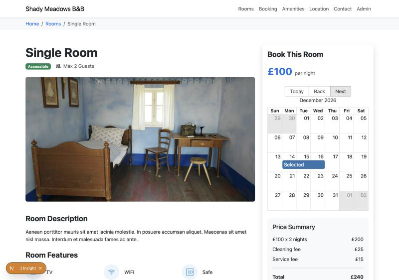
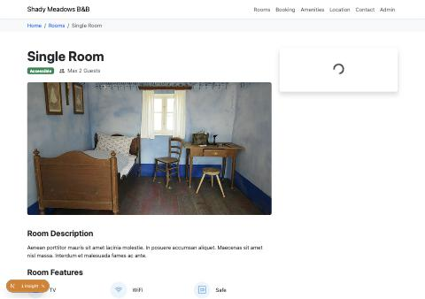

# Candidates (CAND-08 to CAND-17)

A candidate becomes a bug once it is reproduced and the expected behavior is backed by an AC or a PO decision. Every entry says which environment it was seen in.

- **Local:** restful-booker-platform at commit `efe2deb`, http://localhost:3003, run 2026-11-25 (re-checks 2026-11-26).
- **Demo:** https://automationintesting.online (down since 2026-11-23).

| ID | Proposed severity | Summary | TCs | Seen on | Status |
|---|---|---|---|---|---|
| CAND-08 | Medium | Past dates are accepted **and booked** | TC-037 | Demo 11-23 (home only) · Local 11-25 (booking stored) | Needs PO decision (PO-2) |
| CAND-09 | Medium | Endless spinner when the room API fails (500) | — | Demo 11-23 | Candidate |
| CAND-10 | Low | The calendar shades the check-out day as "Selected" | TC-001, 002, 011, 013, 038, 049 | Local 11-25 | Needs PO decision (PO-4) · verify on demo |
| CAND-11 | Low | Leading and trailing spaces count toward name length | TC-018 | Local 11-25 | Needs PO decision (PO-3) |
| CAND-12 | Medium | Room URL without dates: the booking panel spins forever | TC-039 | Local 11-25 | Candidate · verify on demo |
| CAND-13 | Medium | Invalid date params: the Price Summary shows £NaN | TC-040 | Local 11-25 | Candidate · linked to BUG-02 |
| CAND-14 | Medium | Room that doesn't exist: API 500 and an error page (should be 404) | TC-041 | Local 11-25 | Candidate · verify on demo |
| CAND-15 | High | The submit button isn't disabled after the first click: double POST, and an error shown after a booking that worked | TC-034 | Local 11-25 | Candidate |
| CAND-16 |  | The booking summary says "1 nights" (wrong plural) for a 1-night stay | TC-006 | Local 11-26 | Candidate |
| CAND-17 |  | Moving Check In past the current Check Out leaves Check Out before Check In, with no warning | TC-053 | Local 11-26 | Candidate · linked to BUG-02 |

---

## CAND-08 · Past dates are accepted and booked
- **Demo, 11-23:** the home page offers all rooms for 10/10/2026 → 12/10/2026, with no message.
- **Local, 11-25 (TC-037):** same on the home page. Submitting valid data gives "Booking Confirmed" 2026-10-10 - 2026-10-12, and the booking is stored (`/api/report/room/1`). So the backend accepts past dates too.
- **Open question:** no AC covers past dates, so this is a question for the PO (PO-2).

## CAND-09 · Endless spinner when the room API fails
- **Demo, 11-23:** while `GET /api/room/{id}` returned 500, the room page spun forever and showed no message.
- **Console:** `SyntaxError: Unexpected token 'I', "Internal S"... is not valid JSON`.
- **Pattern:** the read-side twin of BUG-01, a missing error handler. See also CAND-14.

## CAND-10 · The calendar shades the check-out day
- **Local, 11-25:** the "Selected" bar always runs from check-in through check-out, including check-out. For example, 14–16 Dec shades 14, 15 and 16.
- **Seen in:** TC-001, 002, 011, 013, 038 and 049.
- **TC-015** shows a new booking can start on another booking's check-out day, so this looks like a display issue only.
- **Possible version difference:** the UI map, written from the demo, says the bar covers the nights. Verify on the demo.

## CAND-11 · Spaces count toward name length
- **Local, 11-25 (TC-018):** Firstname "  Al  " (two spaces, Al, two spaces), typed with real keystrokes → "Booking Confirmed".
- **Inconsistent rules:** the blank check trims spaces. "   " gives "Firstname should not be blank" (TC-022). The length check does not trim.

## CAND-12 · Room URL without dates leaves the booking panel spinning forever
- **Local, 11-25 (TC-039):** `/reservation/1` loads the room details.
- "Book This Room" shows a spinner for 40 s or more, with no prompt, no Price Summary and no Reserve Now.
- Every API call returned 200.

## CAND-13 · Invalid date params show £NaN
- **Local, 11-25 (TC-040):** `/reservation/1?checkin=abc&checkout=xyz` → "£100 x NaN nights", £NaN, Total £NaN, with no prompt to pick dates.
- Submitting shows "Failed to create booking" in the red box: no crash, but no explanation either.
- **Linked to BUG-02:** the dates in the URL are not validated before the price is calculated.

## CAND-14 · Room that doesn't exist returns 500 and an error page
- **Local, 11-25 (TC-041):** `/reservation/99` → `GET /api/room/99` → **500** → "This page couldn't load".
- **Expected:** 404 and a clear "room not found" message, or a redirect home.

## CAND-15 · The submit button isn't disabled after the first click
- **Local, 11-25 (TC-034):** a real double click on "Reserve Now" sends two POSTs.
  - The first returns **201 Created**.
  - The second returns **409**, which triggers BUG-01's crash.
- Only one booking is stored, but the user sees "This page couldn't load" after a booking that succeeded, and may book again.
- **Separate from BUG-01:** even with good error handling, the second POST shouldn't be sent.

## CAND-16 · The booking summary says "1 nights"
- **Local, 11-26 (TC-006):** for a 1-night stay (2027-01-11 to 2027-01-12, room 1), the Price Summary reads "£100 x 1 nights".
- The amounts are correct (£100, £25, £15, Total £140). Only the plural is wrong; it should read "1 night".

## CAND-17 · Check Out is left before a new Check In
- **Local, 11-26 (TC-053 re-check):** on the home page, Check Out was prefilled as 27/11/2026. After Check In was set to 15/03/2027 with the date picker, Check Out stayed at 27/11/2026, before the new Check In, with no warning.
- The "Book now" links then carried `checkin=2027-03-15&checkout=2026-11-27`.
- **Linked to BUG-02:** the same missing date-range validation, reached by changing Check In instead of Check Out.
